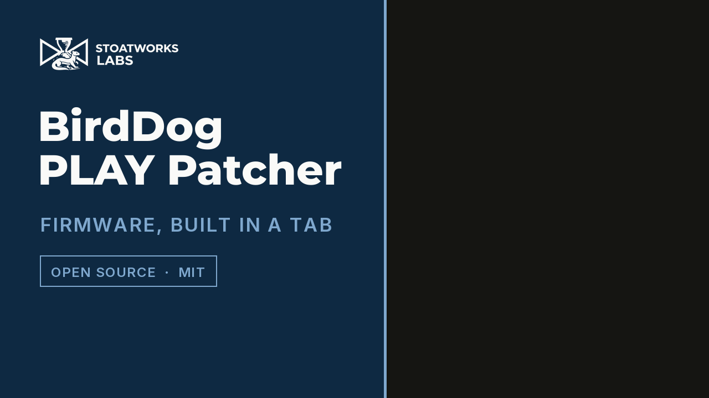

# BirdDog PLAY Patcher

> **AI-assisted project.** This codebase was created with [Claude Code](https://claude.com/claude-code)
> (Anthropic), directed and reviewed by a human author. I worked out the package format by static
> analysis of the stock updater, and the resulting package has been installed on a real BirdDog
> PLAY (firmware 1.0.30), where SSH, Tailscale and the NDI KVM endpoint all work on the hardware.
> The archive writer is checked byte-for-byte against `tar` in CI. That's **one unit on one
> firmware version**, though. It hasn't been tested across the range of PLAY and Pod firmwares
> out in the field.

This builds an installable `.fw` for a [BirdDog PLAY](https://birddog.tv) that adds an SSH key,
[Tailscale](https://tailscale.com), an NDI KVM endpoint, a
[USB media player](player/), a
[UVC converter](converter/) and a
[streaming gateway](gateway/). With those, a PLAY can be reached and managed remotely, drive the
machine it's displaying, play video, stills and PDFs off a USB stick, turn a USB camera into NDI,
and take RTMP, RTSP, HLS, WebRTC and UDP streams onto its HDMI output and send that camera back
out the same ways. Not bad for a little box whose day job is decoding NDI to HDMI. It also takes
**modules of your own**: a `.tgz` with an `install` script that the package's installer runs on
the device alongside those payloads (see [Custom modules](#custom-modules)).

**Live: <https://birddog-play-patcher.stoatworks-labs.com>**

The package is put together entirely in your browser. Nothing is uploaded, you don't need an
account, and **you don't need your existing firmware file** either: the generated package is a
standalone overlay installer, not a modified copy of BirdDog's firmware.

[](https://www.youtube.com/watch?v=z7RWEk11Egc)

*46 seconds at the live address, driven through the tool's own controls. The Tailscale release
does get fetched and checked against its published SHA-256 during the take, and the 34.9 MB
package at the end was built in the tab.*


---

## Why no upload, and no decryption

BirdDog's updater extracts the uploaded archive and runs `./update` from it as root:

```bash
tar xf "$UPDATE_PACKAGE" -C "$UPDATE_DIR"
pushd "$UPDATE_DIR"
if ! [[ -e "./update" ]]; then ... fail ... fi
./update
```

There's **no signature check anywhere in that chain**. So a valid package is just a gzip'd tar
with an executable `update` at the top level, and this tool's is a readable bash script rather
than a vendor binary.

That's why this tool can be a static page: there's no payload to decrypt and no key involved,
so there's nothing to upload and nothing to protect server-side. The only server-side part is a
proxy for `pkgs.tailscale.com`, which doesn't send a CORS header.

**This repository contains no BirdDog firmware, no vendor keys and no way to decrypt one.**
It only ships code written for this project.

## What gets installed

| Path | What | Survives a vendor firmware update? |
|---|---|---|
| `/root/.ssh/authorized_keys` | your key, appended, mode 600 | yes — the vendor installs with `cp -rf`, which is additive |
| `/userdata/tailscale/` | `tailscaled` + `tailscale`, 68 MB | expected, but not guaranteed |
| `/userdata/bd-kvm/` | `bdkvm` + `run.sh` | yes — deliberately not `/userdata/birddog-kvm`, which the vendor updater deletes |
| `/etc/systemd/system/bd-{tailscaled,kvm}.service` | units | yes |
| `/userdata/bd-gw/` | streaming gateway (beta): `mediamtx` 62 MB, `bdgw`, its `config.json` | expected, but not guaranteed |
| `/etc/systemd/system/bd-{mtx,gw}.service` | gateway units | yes |
| `/userdata/bd-probe.txt` | first-boot hardware report | yes |
| `/userdata/bd-modules.log` | one line per custom module the installer ran | yes |

Everything substantial lives on the `/userdata` partition. The installer:

- **refuses to run** unless `/etc/birddog-hardware-version` reads `BirdDog PLAY` or `BirdDog Pod`;
- never touches `sshd`, `sshd_config`, `birddog-update-wrapper`, `BirdDogUpdateRunner` or
  `birddog-web-ui`, since those are how you get back in if something goes wrong;
- **can't reach the kernel or bootloader**, which aren't in this package format at all, so a
  bad install can't break the boot chain;
- is idempotent, and doesn't reboot unless you ask it to.

Read [`installer/update`](installer/update) before you run it. It's 500 lines of commented
bash, it runs as root on your device, and you shouldn't take anyone's word for what it does,
mine included.

## Tailscale

It's installed but **not authenticated**. There's no auth key baked into the package, because it
would sit in cleartext both in the archive and on the device. After installing:

```bash
ssh -p 9031 root@<play-ip>
/userdata/tailscale/tailscale --socket=/run/bd-tailscaled.sock up
```

Stock PLAY firmware has no `/dev/net/tun` and ships no kernel modules at all, so Tailscale runs
in userspace-networking mode. **Inbound still works**: SSH, the web UI and the `:8080` API are
all reachable over the tailnet, because tailscaled's netstack proxies inbound TCP to local
listeners. Measured throughput is ~195 Mbps against a 920 Mbps wired baseline, which is
comfortable for NDI|HX and SRT but not enough for full-bandwidth NDI.

> **Before you put a PLAY on a tailnet:** its REST API on `:8080` has **no authentication of any
> kind** and sets `Access-Control-Allow-Origin: *`. Joining a tailnet doesn't change that:
> anyone who can reach the device on the tailnet can reconfigure it without credentials. Scope
> an ACL for the node; the device has no access control of its own to fall back on.

## NDI KVM

[`agent/`](agent) is `bdkvm`, a small Go program that reads the keyboard and mouse on the PLAY's
USB-A port and forwards them to the NDI source the PLAY is displaying, as `<ndi_kvm>` metadata.
It opens its own receiver at metadata-only bandwidth, so it costs nothing on the wire and sits
happily alongside the PLAY's own receiver.

It uses the **free NDI SDK only**, and `dlopen`s the device's existing `libndi` at runtime
rather than linking it, so no NDI code is redistributed here.

## Streaming gateway (beta)

The gateway ([`gateway/`](gateway/), bdgw) puts
[MediaMTX](https://github.com/bluenviron/mediamtx) on the box as a protocol hub (RTMP, RTSP,
HLS, WebRTC/WHIP, SRT and UDP in; RTSP, RTMP, HLS, WebRTC and SRT served; RTMP(S), RTSP, SRT
and WHIP pushed out) and adds a **Streaming** tab to the web UI. The picture gets to HDMI
through **the PLAY's own decoder**: the tab points it at the chosen path as an SRT source on
loopback, using the three files the stock AV Setup page writes plus a restart. So the OSD, tally
and web UI stay in charge, and if the hub dies the PLAY just goes back to behaving like a PLAY.
Point the UVC converter's SRT output at `srt://127.0.0.1:8890?streamid=publish:cam` and the
camera is on every protocol the hub speaks.

MediaMTX is 62 MB unpacked, which is over the 25 MiB static-asset cap, so the page fetches the
**pinned** release through the Worker (GitHub's release host doesn't send a CORS header either,
same as `pkgs.tailscale.com`) and checks it against the `checksums.sha256` published beside it.
The pin lives in [`src/worker.js`](src/worker.js). CI reads it from there, fails if
`gateway/render.go` names a different one, and validates the gateway's rendered configuration
against that release specifically. birddog-re's `fwbuild` stages the same one, so bump all
three together.

**Not yet run on a PLAY.** Ports 1935, 8554, 8888, 8889 and 8890/udp are open with no
credentials, just like the stock API on `:8080`. Read [`gateway/README.md`](gateway/README.md) for the ceilings (H.264
to 1080p60/2160p30, HEVC to 2160p60; WebRTC must send H.264) and the hardware list.

## Custom modules

The four payloads above are modules in all but packaging, and the generator takes yours too.
A **module** is a directory (`module.conf` with `NAME` and `VERSION`, an executable `install`,
and whatever payload it needs) shipped as a `.tgz`. Choose it under *Custom modules*. The page
reads it in the browser, checks its structure and writes it into the `.fw` at
`modules/<name>/`. On the device, `update` runs each `modules/*/install` as root, from that
directory, after its own payloads.

What the installer wraps around a module limits the *accidental* failures. Each one runs in a
subshell, under `timeout 600` where the command exists (Debian 10's coreutils has it), and a
non-zero exit is logged and skipped, so a module that fails, exits non-zero or hangs can't stop
the `BirdDogRunner` restore at the end, which is what brings the picture back. It does nothing
about deliberate ones: a module runs as root and can reboot, stop the display or kill the
updater if it feels like it. The page refuses what the format can't carry (paths over ustar's
100 bytes, symlinks, a non-aarch64 ELF, a name that collides with a built-in payload) and
checks **nothing** about what `install` does. That's the author's business, and the page says so.

The contract (the environment, `bd_log`, and the rules that keep a unit recoverable) is written
up at [`/modules.html`](https://birddog-play-patcher.stoatworks-labs.com/modules.html), and
[`module-template/`](module-template/) is a
complete working module to start from, with a `build.sh` and CI that prove the generator
accepts what it produces. The CLI builder in the research repo takes the same archives with
`--module`, so the two builders can't disagree about what a valid module is.

## Development

```bash
scripts/build-assets.sh      # assemble public/assets/ from installer/ and agent/dist/
npx wrangler dev             # serve locally
node test/build-package.mjs  # build a package in Node and verify its structure
MTX_TGZ=/path/to/mediamtx_v1.21.0_linux_arm64.tar.gz node test/build-package.mjs   # offline
node test/modules.mjs        # read module archives written by the system tar
```

Everything the package installs on the device has its source here. Each Go program is its
own module with its own `build.sh`, which writes the `dist/` binary this repo commits and the
page serves. Build, test on a unit, then commit the binary:

| Folder | Program | Guide |
|---|---|---|
| [`agent/`](agent/) | bdkvm, the NDI KVM endpoint (synced from the research repo) | — |
| [`player/`](player/) | bdplay, the USB media player, plus the PDFium and exFAT helpers | [`player/docs/USER-GUIDE.md`](player/docs/USER-GUIDE.md) |
| [`converter/`](converter/) | bdcam, the UVC converter (its `build.sh` needs zig) | [`converter/README.md`](converter/README.md) |
| [`gateway/`](gateway/) | bdgw, the streaming gateway panel | [`gateway/README.md`](gateway/README.md) |
| [`tailscale-ui/`](tailscale-ui/) | bdts, the birdUI Tailscale panel | [`tailscale-ui/docs/USER-GUIDE.md`](tailscale-ui/docs/USER-GUIDE.md) |
| [`module-template/`](module-template/) | a working third-party module to start from | [`module-template/README.md`](module-template/README.md) |

Until 2026-10-11 the last five were separate repositories; their history came with them.

`public/fw.js` holds the archive logic and has no DOM or network calls in it, on purpose, so
the Node test exercises the same module the browser runs rather than a reimplementation. The
test checks that the `update` inside a generated package is byte-identical to
[`installer/update`](installer/update) in this repo, and it carries a fixture module packed by
the **system** tar (GNU tar in CI, bsdtar on a Mac), so the module reader is checked against
what actual tar programs emit (pax headers, GNU long names, ustar prefixes) rather than against
`fw.js` marking its own homework.

**The tar layer is reproducible; the `.fw` isn't.** Identical inputs produce a byte-identical
tar in both Chrome and Node, but the two engines configure zlib differently, so the same tar
gzips to different bytes. Compare tar digests across engines, never `.fw` digests.

## Recovering a unit

Nothing here writes to the kernel, bootloader or partition table. If an install goes wrong,
reflash stock firmware through the normal web UI, or use Rockchip recovery mode. Bear in mind
that recovery restores *factory* state, not the unit's provisioned serial, hostname or
`/userdata`.

To remove everything this installs:

```bash
systemctl disable --now bd-tailscaled bd-kvm
rm -rf /userdata/tailscale /userdata/bd-kvm /etc/systemd/system/bd-{tailscaled,kvm}.service
```

<!-- attributions:start -->
This project is built on other people's work — see [ATTRIBUTIONS.md](ATTRIBUTIONS.md).
<!-- attributions:end -->

## Licence

MIT — see [LICENSE](LICENSE). Not affiliated with, endorsed by, or supported by BirdDog.
Installing this will not do your warranty any favours.
