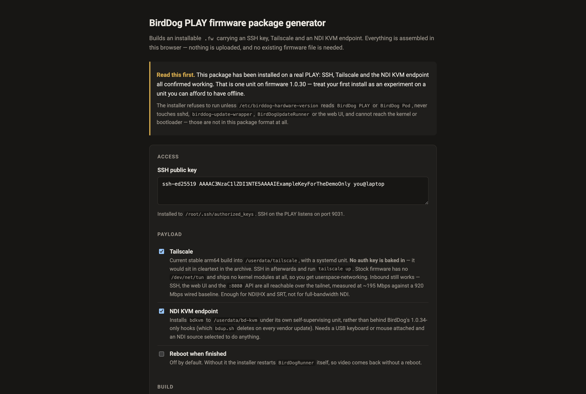

# BirdDog PLAY Patcher user guide

BirdDog PLAY Patcher builds an installable `.fw` for a [BirdDog PLAY](https://birddog.tv) that
adds **an SSH key, Tailscale, an NDI KVM endpoint, a USB media player, a UVC converter, a
streaming gateway and an OMT receiver**, plus **modules of your own**. With those, a PLAY can be
reached and managed remotely, drive the machine it's displaying, play video, stills and PDFs off a
USB stick, turn a USB camera into an NDI, SRT or HDMI source, take RTMP, RTSP, HLS, WebRTC and UDP
streams onto its screen and send that camera back out the same ways, and show Open Media
Transport sources.

**The package is put together entirely in your browser.** Nothing is uploaded, you don't need an
account, and **you don't need your existing firmware file** either: the generated package is a
standalone overlay installer, not a modified copy of BirdDog's firmware.



> **Before you rely on this:** I worked out the package format by static analysis of the stock
> updater, and the resulting package **has been installed on a real BirdDog PLAY**. SSH, Tailscale
> and the NDI KVM endpoint all work on the hardware, the media player and the UVC converter run on
> a test unit and are marked **beta**, and the archive writer is checked byte for byte against
> `tar` in CI.
>
> **That's one unit on one firmware version (1.0.30).** It hasn't been tested across the range
> of PLAY and Pod firmwares in the field. Treat your first install as an experiment on a unit you
> can afford to have offline.
>
> This codebase was created with AI assistance, directed and reviewed by a human author.

---

## Building and installing a package

1. **Paste your SSH public key**: the single line from your `.pub` file, starting `ssh-ed25519`
   or `ssh-rsa`. It's appended to `/root/.ssh/authorized_keys` on the device. The page refuses a
   private key, more than one line, or anything `sshd` wouldn't load.
2. **Choose the payload.** Tailscale is on by default; the NDI KVM endpoint, the USB media player,
   the UVC converter and the streaming gateway are off. Each option says what it installs and, for
   the three beta ones, what's known to be rough. *Reboot when finished* is off by default; without
   it the installer brings the display back itself.
3. **Optionally add your own modules** under *Custom modules* (see [Custom modules](#custom-modules)).
4. **Build.** The build tag names the file and is logged on the device. If you want to pin a
   Tailscale version or build offline, supply `tailscale_<version>_arm64.tgz` yourself; otherwise
   the current stable release is fetched and checked against its published SHA-256.
5. **Download the `.fw`** and upload it on the PLAY's web UI firmware page, just as you would a
   vendor release. The installer's progress appears in the same live log, prefixed `[custom]`.
6. **Read the first-boot report** at `http://<play-ip>/static/bd-probe.txt`. It works even if the
   SSH key didn't take, and says whether `/dev/net/tun` exists, how much space is free, what's on
   the USB port and which modules ran. Delete it when you're done:
   `rm /srv/birddog-web-ui/static/bd-probe.txt`. That path is served without authentication,
   which is why the report carries hardware facts and nothing secret.
7. **SSH in** with `ssh -p 9031 root@<play-ip>`. The full install log is at
   `/tmp/bd-custom-install.log`.

---

## Why there is no upload and no decryption

BirdDog's updater extracts the uploaded archive and runs its `update` script **as root**. There's
**no signature check anywhere in that chain**.

So a valid package is just a gzipped tar with an executable `update` at the top level, and this
one's is **a readable bash script rather than a vendor binary.**

That's why this tool can be a static page: there's no payload to decrypt and no key involved, so
there's nothing to upload and nothing to protect server-side. The only server-side part is a
proxy for two download hosts that don't send a CORS header: Tailscale's, and GitHub's release
downloads for the streaming gateway's pinned MediaMTX.

**This project contains no BirdDog firmware, no vendor keys, and no way to decrypt one.**

> **Read the installer before you run it.** It's over 700 lines of commented bash, it runs as root
> on your device, and you shouldn't take anyone's word for what it does.

---

## What gets installed

| Path | What | Survives a vendor firmware update? |
|---|---|---|
| `/root/.ssh/authorized_keys` | your key, appended, mode 600 | **yes** — the vendor installs additively |
| `/userdata/tailscale/` | `tailscaled` + `tailscale`, 68 MB | expected, but not guaranteed |
| `/userdata/bd-tailscale-ui/` | the Tailscale panel for the web UI's System page | expected |
| `/userdata/bd-kvm/` | the KVM agent | **yes** — deliberately *not* the path the vendor updater deletes |
| `/userdata/bd-play/` | the USB media player, PDF renderer and exFAT helper | expected |
| `/userdata/bd-cam/` | the UVC converter and its settings API | expected |
| `/userdata/bd-gw/` | the streaming gateway: MediaMTX, its panel and its settings | expected |
| `/userdata/bd-omt/` | the OMT receiver, its codec and its settings | expected |
| `/userdata/bd-<name>/` | each custom module, by convention | expected |
| `/etc/systemd/system/bd-*.service` | units | yes |
| `/userdata/bd-probe.txt` | first-boot hardware report | yes |
| `/userdata/bd-modules.log` | one line per custom module the installer ran | yes |

**Everything substantial lives on the `/userdata` partition.** The installer:

- **refuses to run** unless the device identifies itself as a BirdDog PLAY or Pod;
- **never touches** `sshd`, its config, the update wrapper, the update runner or the web UI,
  because **those are how you get back in if something goes wrong**;
- **can't reach the kernel or bootloader**, which aren't in this package format at all, so **a
  bad install can't break the boot chain**;
- is idempotent, and doesn't reboot unless you ask it to.

Four options edit one web UI page, `videoset.html`, to add themselves to it: the media player's
**USB** source, the converter's **UVC Converter** tab, the gateway's **Streaming** tab and the OMT
receiver's **OMT** tab. Each
edit is marker-wrapped, backed up beside the file and exactly reversible. Afterwards the installer
restarts the web UI, checks it came back as a new process and answers, and rolls the edit back if
it didn't. The Tailscale panel does the same to the System page.

---

## Tailscale

It's installed but **not authenticated**. There's no auth key baked into the package, because it
would sit in cleartext both in the archive and on the device. Instead the package adds a
**Tailscale panel to the System page of the PLAY's own web UI**: open it in a browser, start the
login and follow the link it shows. Changing anything there needs a web UI login; reading the
status doesn't. If you'd rather, SSH in on port 9031 and run
`/userdata/tailscale/tailscale --socket=/run/bd-tailscaled.sock up` instead.

Stock PLAY firmware has **no TUN device and ships no kernel modules**, so Tailscale runs in
userspace-networking mode. **Inbound still works**: SSH, the web UI and the API are all reachable
over the tailnet, because the daemon proxies inbound connections to local listeners. The node
can't advertise routes or act as an exit node, and the panel says so rather than offering
switches that would fail.

**Measured throughput is ~195 Mbps against a 920 Mbps wired baseline**: comfortable for NDI|HX and
SRT, **not enough for full-bandwidth NDI.**

> **Before you put a PLAY on a tailnet:** its REST API on port 8080 has **no authentication of any
> kind** and allows any origin. **Joining a tailnet doesn't change that**: anyone who can reach
> the device on the tailnet can reconfigure it without credentials. **Scope an ACL for the node**;
> the device has no access control of its own to fall back on.

---

## NDI KVM

A small agent reads the keyboard and mouse on the PLAY's USB-A port and forwards them to **the NDI
source the PLAY is displaying**, as KVM metadata.

It opens its own receiver **at metadata-only bandwidth**, so it costs nothing on the wire and sits
alongside the PLAY's own receiver. It needs a keyboard or mouse attached and an NDI source
selected before it'll do anything, and it polls for hotplug itself. It doesn't rely on any vendor
hooks, because those are a 1.0.34 feature that a vendor update deletes anyway.

It uses the free NDI SDK only, and loads the device's existing library at runtime rather than
linking it, so no NDI code is redistributed.

---

## USB media player (beta)

This adds a **USB** entry to the source dropdown and plays video, stills and PDFs off a USB stick,
hardware-decoded straight to HDMI, in order or shuffled, looping until you stop it. Control it
from that page, or from `http://<play-ip>:8091/`. Selecting USB stops BirdDog's decoder so the
player can take the display; switching back to NDI restores it.

**Why beta:** repeatedly switching between USB and NDI destabilises BirdDog's own decoder. It
restarts each time and the player checks it came back, but expect the odd dropout if you keep
flicking between sources; treat USB as a mode you set. Playback has been proven from internal
storage and a loopback exFAT volume, **not yet with a physical stick hotplugged.** PDF needs the
PDFium helper and exFAT sticks need the FUSE helper; the page tells you which of those your build
carries.

---

## UVC converter (beta)

This turns the PLAY into a converter the other way round: a USB camera on its USB-A port, out as
**NDI**, **NDI|HX**, **SRT** or **HDMI**, in any combination, from one capture. Settings live in a
**UVC Converter** tab in the web UI, or on `http://<play-ip>:8090/`. A UVC 1.5 camera is bound
automatically; otherwise this kernel's driver silently ignores 1.5 devices.

**Why beta:** every claim is measured on one test unit and one camera. NDI|HX uses a packet layout
reconstructed from documentation rather than a header, so a future NDI runtime could change it,
and you'd see that as a picture fault. And at heights that aren't a multiple of 16, 1080 among
them, the bottom 8 rows show as a green band, because the decoder ignores the crop the standard
puts in the stream.

---

## Streaming gateway (beta)

This makes the PLAY a streaming endpoint in both directions. **In:** push RTMP from OBS, vMix or
an encoder to `rtmp://<play-ip>:1935/live`, pull an RTSP camera or an HLS playlist, publish WHIP
from a browser, or receive MPEG-TS or RTP over UDP, then choose which of them is on the HDMI
output. **Out:** the UVC converter's camera served over RTSP, RTMP, HLS, WebRTC and SRT, and
pushed to YouTube, Twitch or any RTMP(S), RTSP, SRT or WHIP destination. Everything is set up on a
**Streaming** tab in the web UI (or the same API on `http://<play-ip>:8093/`), which needs your
birdUI login because it holds stream keys.

The box runs [MediaMTX](https://github.com/bluenviron/mediamtx) as the hub. The picture reaches the
screen through **the PLAY's own decoder**, which the tab points at the chosen path as an SRT source
on loopback. So the OSD, tally and the rest of the web UI carry on as before, and if the hub
stops, the PLAY just goes back to being a PLAY. To put the camera on the hub, set the UVC
converter's SRT destination to the address the Streaming tab prints
(`srt://127.0.0.1:8890?streamid=publish:cam`).

**Why beta:** this option **hasn't run on a PLAY yet**. What it relies on was read out of the
firmware and measured by the projects beside it, and its configuration is checked against the
actual MediaMTX in CI, but the decoder reading the hub's SRT over loopback is unproven until the
test unit is back. Ports 1935, 8554, 8888, 8889 and 8890/udp are open with **no credentials**,
just like the stock API on `:8080`, so the LAN or the tailnet is the boundary. The decode limits
are the chip's: H.264 to 1080p60 or 2160p30, HEVC to 2160p60; WebRTC publishers must send H.264.
YouTube refuses video without audio, and the converter hasn't got any yet.

---

## OMT receiver (beta)

This shows an [Open Media Transport](https://github.com/openmediatransport) source on the HDMI
output, with its sound. OMT is the open video-over-IP protocol that came out of vMix, and the
PLAY's own decoder doesn't speak it. Open the **OMT** tab in the web UI, pick a source from the ones
announcing themselves on the network (or type `host:port` for one on another subnet), and press
**SHOW ON HDMI**. The same controls are on `http://<play-ip>:8094/`, behind your birdUI login.

Like the USB media player, it **takes the display**: the PLAY's decoder is stopped while a source
is shown, so NDI, the OSD and tally are gone until you press **STOP**, which starts it again. A
source that was showing comes back after a power cut.

**Why beta:** it **hasn't run on a PLAY yet**. Off the device it has received a real OMT sender at
1080p60 and its pipelines have run under the PLAY's GStreamer version, but whether the PLAY keeps
up with 1080p60 is modelled, not measured, so **720p is the safer bet** for now. Interlaced sources
are refused and the sound runs a little late. Its own
[user guide](https://github.com/stoatworks-labs/birddog-play-patcher/blob/main/omt/docs/USER-GUIDE.md)
has the settings and what to do when it won't show.

---

## Custom modules

Under **Custom modules** you can add your own payloads. A module is a small `.tgz` holding a
`module.conf` (its name and version) and an `install` script. The page reads it in your browser,
checks it's well-formed, and writes it into the package at `modules/<name>/`. On the device, the
installer runs each module's `install` **as root**, after the payloads above.

**Nothing about what `install` does is checked**, only that the package format and the device can
carry the archive. Read what you package. Each chosen file is listed with a tick or the reason it
was refused, and a refused file blocks the build rather than being silently dropped.

A module that fails, exits non-zero or hangs can't leave the unit dark. The installer runs each
one on its own, stops it after ten minutes (Debian's `timeout`, which stock PLAY firmware carries;
without it a hang isn't caught), logs the failure and carries on, so the step that restarts
BirdDog's display still runs. What it can't contain is a module that *deliberately* reboots, stops
the display without restarting it, or kills the updater. It runs as root, and only reading it
protects you from that. Everything each module printed is in `/tmp/bd-custom-install.log` on the
device, and the probe report ends with one line per module and its exit code.

To write one, start from the template in
[module-template/](https://github.com/stoatworks-labs/birddog-play-patcher/tree/main/module-template)
and read *Building a module* on the site. A module built from the template can be removed with
`bash /userdata/bd-<name>/uninstall` over SSH.

---

## Undoing it

Over SSH, run the lines for each option you installed, in this order. For the gateway, clear
**Show on HDMI** in its tab first so the decoder is handed back, and for the OMT receiver press
**STOP** on its tab.

```
# USB media player
systemctl disable --now bd-play
/userdata/bd-play/bdplay -unpatch-ui
/userdata/bd-play/bdplay -unregister-osd-entry
# UVC converter
systemctl disable --now bd-cam bd-cam-api
/userdata/bd-cam/bdcam --unpatch-ui /srv/birddog-web-ui
# streaming gateway
systemctl disable --now bd-mtx bd-gw
/userdata/bd-gw/bdgw --unpatch-ui
# OMT receiver
systemctl disable --now bd-omt
/userdata/bd-omt/bdomt --unpatch-ui
# Tailscale and its System page panel
systemctl disable --now bd-tailscale-ui bd-tailscaled
/userdata/bd-tailscale-ui/bdts --unpatch-ui
# NDI KVM endpoint
systemctl disable --now bd-kvm
# then, whatever you installed
systemctl restart BirdDogWebUI
rm -rf /userdata/tailscale /userdata/bd-{tailscale-ui,kvm,play,cam,gw,omt} \
  /etc/systemd/system/bd-{tailscaled,tailscale-ui,kvm,play,cam,cam-api,mtx,gw,omt}.service \
  /userdata/bd-probe.txt /userdata/bd-modules.log /srv/birddog-web-ui/static/bd-probe.txt
```

Each service stops before its page edit comes out, because the player puts its **USB** entry
back every time it starts. The player goes first because its unpatch puts back the whole page as
it found it, which can include the converter's, the gateway's and the OMT receiver's tabs; theirs
take out only their own. Copies of each page as it was found stay beside them in
`/srv/birddog-web-ui/` as `settings.html.bdts-stock`, `videoset.html.bdcam-orig`,
`videoset.html.bdgw-stock` and `videoset.html.bdomt-stock`. Your key
stays in `/root/.ssh/authorized_keys`, and a module built from the template leaves
`bash /userdata/bd-<name>/uninstall`.

Then reflash stock firmware if you want a clean unit. Recovery-mode flashing of the factory image
is a proven path, but it restores **factory** state, not this unit's provisioned serial, hostname
or `/userdata`.

---

## If something is wrong

| Symptom | Cause |
| --- | --- |
| **The installer refused to run** | The device does not identify as a PLAY or Pod. That check is deliberate. |
| **The screen went dark after the upload** | The vendor's update wrapper stops the display before running any installer. Ours restarts it when it finishes; wait for the log to say so. If it stays dark, power-cycle — nothing here can touch the boot chain. |
| **Tailscale is installed but the device is not on the tailnet** | It is not authenticated — no auth key ships in the package. Sign in from the Tailscale panel on the System page, or bring it up over SSH. |
| **Full-bandwidth NDI is unusable over the tailnet** | Userspace networking tops out around 195 Mbps. Use NDI|HX or SRT. |
| **The KVM agent does nothing** | It forwards to the source the PLAY is *displaying*, and needs a keyboard or mouse on the USB-A port. Check what is on screen and what is plugged in. |
| **A USB stick does not mount** | An exFAT stick needs the FUSE helper, which the page says whether your build carries. FAT32 and NTFS mount without it. |
| **A stream is pushed to the PLAY but nothing is on screen** | Pick the path under **Show on HDMI** on the Streaming tab and press SWITCH — the decoder is only pointed at a path when you ask. If the tab shows the publisher connected and the screen stays black, the codec is outside the chip's limits (H.264 above 2160p30, or VP8/VP9/AV1 from a browser). |
| **The Streaming tab says the device has no password** | Set a birdUI password on the System page; the tab refuses to hold stream keys behind a login that anyone can pass. |
| **A USB camera never appears** | A UVC 1.5 camera is bound automatically by the converter; anything else, check `bd-probe.txt` for the USB topology and `journalctl -u bd-cam`. |
| **A vendor update removed something** | `/userdata/tailscale` is expected to survive but is not guaranteed; the KVM path is deliberately placed where the updater does not delete. |
| **A module file is refused** | The message says why: a path over 100 bytes, a symlink, a binary that is not aarch64, a name that collides with a built-in payload, or no `install` at the root. Fix the module or remove the file; the build will not silently leave it out. |
| **A module installed but its service is not running** | Its `install` reported a warning rather than failing the firmware install. Read `/tmp/bd-custom-install.log` and `journalctl -u bd-<name>` on the device. |
