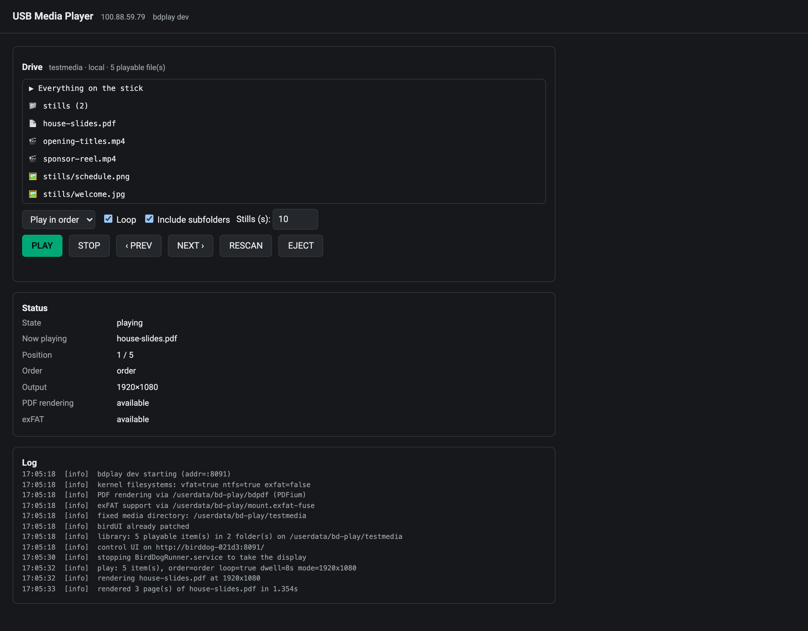
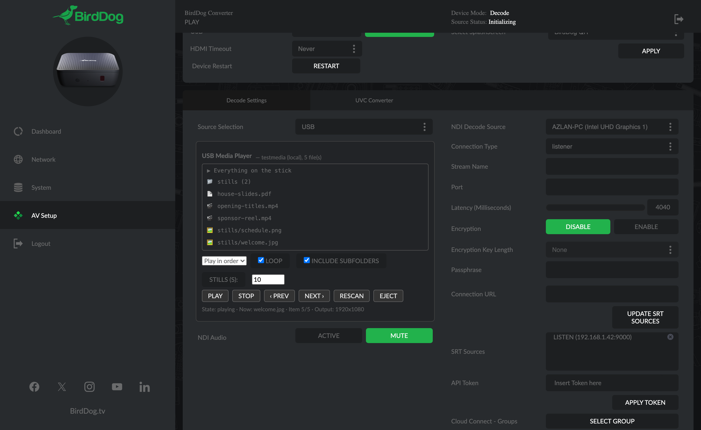

# bdplay user guide

bdplay adds a **USB** entry to the BirdDog PLAY's source dropdown and **plays video, stills and
PDFs from a USB stick straight out of HDMI**, hardware decoded, in order or shuffled, looping
until you stop it.

The PLAY is an NDI/SRT *decoder*, and on its own it has no idea what a USB stick is. This turns one
into a signage player **without giving anything up**: select NDI again and the stock decode path
comes straight back.

> **Before you rely on this:** every claim here was **measured on a real BirdDog PLAY**. Hardware
> video decode, HDMI audio, stills, PDF rendering, the exFAT mount and the display handover with
> BirdDog's own decoder all work on hardware.
>
> That's **one unit on one firmware version.** It hasn't been tested across the range of PLAY and
> Pod firmwares out there, and **USB hotplug with a physical stick is still unverified**: testing
> used a loop device and internal storage.
>
> This codebase was created with AI assistance, directed and reviewed by a human author.

---

## Installing

**The easy way is a checkbox in the [PLAY Patcher](https://birddog-play-patcher.stoatworks-labs.com)**,
which puts the firmware package together in your browser. No toolchain, nothing to compile.

To install by hand, copy the binary and its service unit onto the unit over SSH (**port 9031** on
stock BirdDog firmware) and enable the service.

On start it patches the video settings page to add the USB option. `bdplay -unpatch-ui` takes it
out again, and apart from that one option the stock page is left alone.

---

## Using it

Open the PLAY's own web UI, go to the video settings page, and pick **USB** from Source Selection.
A panel appears with the stick's contents.

**There's also a standalone control page on port 8091**, which shows the log as well. **Use that if
the injected panel doesn't appear**, and go there first when something won't play, because the log
answers most of those questions.

Everything can be driven from the API too, so a Companion button or a cron job works.

### From the TV's remote

If the TV supports HDMI-CEC (Samsung call it Anynet+, LG SimpLink, Sony Bravia Sync, and it's
usually on by default), the PLAY's own on-screen source list already follows the TV's remote. bdplay
adds a **USB-Player** entry to that list: press **Left/Right** to get to the SRT page, **Up/Down** to
it and **OK**. A file browser for the stick comes up on the TV, driven by the same remote:

| Key | Does |
|---|---|
| **Up / Down** | move through the list |
| **OK** | open a folder, or play the file |
| **Left**, **Exit / Return** | back up a folder — and at the top, back to BirdDog |
| **Play** (or the green key) | play everything in this folder, looping |
| **Stop** | while playing: back to the list — in the list: back to BirdDog |
| **‹‹ / ››** (or Left / Right while playing) | previous / next item |
| **Red** | straight back to BirdDog |
| **Blue** / **Yellow** | shuffle / loop on and off |

A single file plays once and goes back to the list; a picture stays up until you press a key. You
can open the same browser from the control page on port 8091 (**OPEN BROWSER ON HDMI**), which also
has the remote's keys as buttons. That's handy when the TV only forwards some of them, which varies
by make. Arrows and OK work on every CEC TV; the transport and colour keys on most.

---

## What it plays

| Type | Formats | How |
|---|---|---|
| **Video** | mp4, mov, mkv, avi, ts, m2ts, mpg, webm, wmv | Hardware H.264/HEVC/VP8/VP9 — **~11% of one core at 1080p** |
| **Stills** | jpg, png, bmp, gif, webp, tif | Scaled to the panel with aspect preserved, held for a configurable dwell |
| **PDF** | pdf | Pages pre-rendered to images, then played as stills — 3 pages at 1080p in ~1.3 s |
| **Office** | pptx, docx, … | **Not rendered.** Listed with "export to PDF" rather than silently ignored |

**PowerPoint is out of scope, on purpose.** Rendering it on the device would mean either a full
office suite, which won't fit or run on 2 GB and four small cores, or a partial renderer that
mangles SmartArt, charts and embedded fonts, **looking broken in exactly the situations where a
deck matters.** Exporting to PDF is one step, and it renders exactly as authored.

---

## Playback options

- **Selection:** one file, one folder (with its subfolders if you like), or the whole stick.
- **Order:** as listed (**natural sort, so `slide2` precedes `slide10`**) or random.
- **Loop:** on by default.
- **Dwell:** how long each still or PDF page holds the screen.

**Random reshuffles the whole set each cycle** rather than picking independently, so every file
plays once per cycle instead of some repeating while others never get a look in, and **the reshuffle
never puts the item that just played at the front of the next cycle.**

---

## If something will not play

| Symptom | Cause |
| --- | --- |
| **The USB option does not appear** | The UI patch did not land. Use the standalone control page on port 8091. |
| **A file is listed but will not play** | Read the log on that page — it answers most of these. |
| **A PowerPoint file is listed and does nothing** | Deliberate. Export it to PDF. |
| **The stick was not picked up** | Hotplug with a physical stick is the one path still unverified. Re-seat it, or reboot with it in. |
| **NDI stopped when I selected USB** | Correct — the stock decoder hands over the display. Select NDI again and it comes back. |
| **The TV remote does nothing in the browser** | The TV is not forwarding keys: check its CEC setting, and that the PLAY is the input it is showing. Use the buttons on the control page meanwhile. |
| **USB-Player is not in the PLAY's on-screen list** | It is on the SRT page of that list (Left/Right), and only while the bd-play service runs. |
