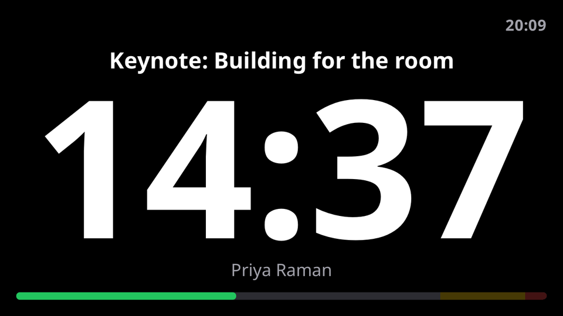
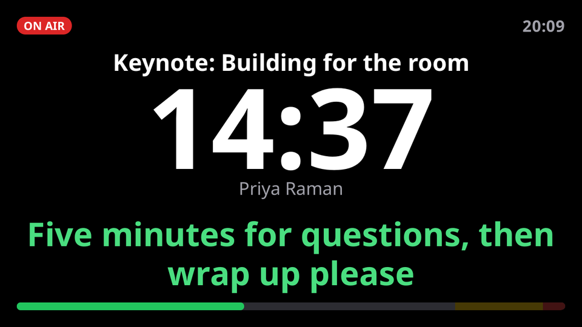
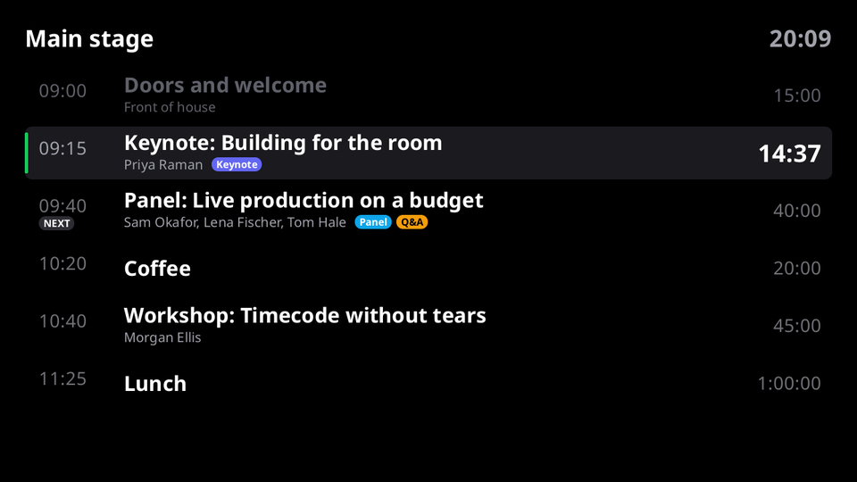
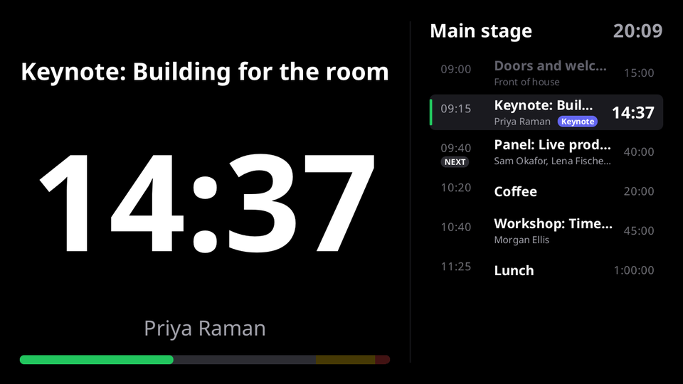
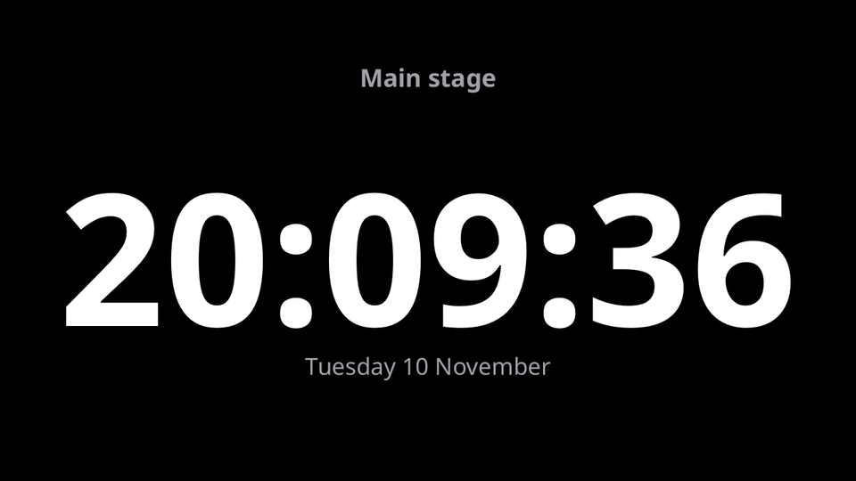

# bdstage: Stagetimer on the BirdDog PLAY

> **AI-assisted project.** This codebase was created with [Claude](https://claude.com/claude-code)
> (Anthropic), directed and reviewed by a human author. **It has not run on a
> BirdDog PLAY yet.** It has run against Stagetimer's real API (with a made-up
> room and key, so only the refusals) and, for the video, inside the PLAY's own
> factory rootfs. [What is verified](#what-is-verified) says exactly which is which.

**A [Stagetimer](https://stagetimer.io) room on a BirdDog PLAY's HDMI output.**
The speaker's countdown, the rundown, both side by side, or the time of day —
live from the room, set up from the PLAY's own web interface.

Installed by the [BirdDog PLAY Patcher](https://birddog-play-patcher.stoatworks-labs.com) as
its *Stagetimer* option, or by `birddog-re`'s `fwbuild --with-stagetimer`, on BirdDog's stock
firmware alongside everything else. Press **STOP** and the PLAY is an NDI decoder again. The
how-to is in [docs/USER-GUIDE.md](docs/USER-GUIDE.md). Until 2026-11-10 this was its own
repository, bd-play-stagetimer, loaded as a custom module.

Not affiliated with Stagetimer.



## How it works

Stagetimer's [API v1](https://stagetimer.io/docs/api-v1/) does not hand out
pictures: it gives the room's state — which timer is selected, when it started
and finishes, whether it is paused, the rundown, the message on screen — over
HTTP and a live Socket.IO feed. So `bdstage` reads that state and draws the
screens itself, in Go, with Noto Sans, and puts each frame on HDMI through
GStreamer's `kmssink` once the PLAY's own decoder has handed the display over.

- **Live.** The socket pushes every change as it happens; the countdown runs
  locally between them, corrected for the PLAY's clock being off.
- **Light.** The picture is redrawn only when something on it changes — once a
  second for a running countdown — and a frame that has not changed is never
  sent again. No browser, no Chromium: one 9 MB binary, under 4 MB in the package.
- **Resilient.** If a venue network blocks WebSockets it reads the room over
  HTTP instead. If Stagetimer is unreachable the countdown keeps running from
  the last state, with a small "Reconnecting" mark.

## The screens

| | |
|---|---|
| **Timer** — the speaker's countdown, as Stagetimer's Viewer shows it: title, speaker, a progress bar with the yellow and red wrap-up zones, the clock in the corner, optionally what comes next. Count-up, time-of-day and hidden timers are drawn as their appearance says |  |
| **Messages** from the Controller, in their colour, bold and upper case as sent |  |
| **Focus messages** fill the screen |  |
| **Agenda** — the rundown with start times, speakers and labels, the current item counting down |  |
| **Split** — the timer beside the agenda |  |
| **Clock** — the time of day in the room's time zone |  |

Also: the timer turns yellow and red at the timer's own wrap-up thresholds and
counts overtime with a minus sign; **Flash** inverts the screen; **Blackout**
blanks it; **On Air** shows a badge; paused timers dim and say so. Every screen
can be mirrored for a teleprompter.

Not drawn: the room's logo and Stagetimer's custom fonts and colours. Stagetimer's
exact look would need its own Viewer page in a browser on the PLAY — a much
heavier thing than this, and not something this module does.

## Install

1. Tick **Stagetimer** in the [PLAY Patcher](https://birddog-play-patcher.stoatworks-labs.com)
   (and leave **Add the Stagetimer tab** ticked), build the package, and upload
   the `.fw` on the PLAY's firmware page.
2. Log in to the PLAY's web interface and open **AV Setup → Stagetimer**.
3. In Stagetimer, open the room's **Controller**, then the menu → **API**: copy
   the room ID and the API key into the tab. **TEST** checks them without
   saving. **APPLY**, then **SHOW ON HDMI**.

The tab previews what the screen shows — or would show, before you take the
PLAY's output away from its decoder.

To take it off again, press **STOP** first, then over SSH:

```bash
/userdata/bd-stage/bdstage --unpatch-ui && systemctl restart BirdDogWebUI
systemctl disable --now bd-stage
rm -rf /userdata/bd-stage /etc/systemd/system/bd-stage.service
```

`config.json` goes with the folder, and with it the room's API key.

## What is installed

```
/userdata/bd-stage/bdstage          this program (9 MB, static Go, no cgo)
/userdata/bd-stage/OFL.txt          the SIL Open Font Licence of the Noto Sans it draws with
/userdata/bd-stage/config.json      the room, the key and the screen options; written 0600 by
                                    bdstage, never shipped, kept across reinstalls
/etc/systemd/system/bd-stage.service  bdstage --serve :8096 --dir /userdata/bd-stage
```

One unit. It runs the API whether or not anything is on screen, so the tab can always say what
is going on. The **Stagetimer** tab is added to `/srv/birddog-web-ui/videoset.html` with the
same anchors the UVC Converter, Streaming, OMT and Output tabs use, so they coexist in whichever
order they went in; the page is backed up first as `videoset.html.bdstage-stock`. The installer
block itself is developed in `birddog-re`'s fwbuild payload and reaches the patcher's
`installer/update` by `scripts/sync-from-re.sh`.

While the timer is on HDMI the PLAY's own decoder is stopped, so its NDI
decoding, OSD and tally are gone until you press **STOP**. After a reboot or a
firmware update the timer comes back on its own (untick "put the timer back on
HDMI" if you do not want that).

## Security

- The tab's controls, the settings and the preview need a valid login to the
  PLAY's own web interface. A unit with **no web-interface password** cannot be
  configured until one is set, because the API key can start and stop the
  room's timers and the screen can be taken over.
- The API key is stored on the PLAY only, readable by root only. It is sent to
  Stagetimer in a header, never in an address, never written to the log, and
  never sent back to the browser: the tab only ever sees its last four
  characters.
- bdstage only reads from Stagetimer. It never calls the endpoints that start,
  stop or edit timers, even though the key would allow it.

## Build

```bash
./build.sh                     # gofmt, vet (host and arm64), tests, tab syntax -> dist/bdstage-linux-arm64
go test -race ./...
```

Any machine with Go 1.26 builds it: `bdstage` is static Go with no cgo, with the
fonts and the tab script inside the binary. `dist/bdstage-linux-arm64` is
committed, and it is what the page serves: a source change ships only when
someone rebuilds it and commits the binary.

### Trying it without a PLAY or a Stagetimer account

```bash
go run ./tools/mockstage                       # a mock Stagetimer on 127.0.0.1:8097; commands on stdin
go run . --serve :8096 --display none --sink png:/tmp/frames --allow-unprotected
go run . --demo /tmp/screens                   # every screen as a PNG
STAGETIMER_API_KEY=… go run . --probe --room <id>   # what a real room sends, for 15 s
```

With the mock, set the room to `mock`, the key to `mock-key-0001` and the API
address to `http://127.0.0.1:8097`. Its commands (`start`, `stop`, `next`,
`left 90`, `msg 0`, `focus 1`, `flash 3`, `blackout`, `block`, …) act like the
Controller.

## What is verified

| | |
|---|---|
| **Stagetimer's API**, HTTP and socket | **Against the real api.stagetimer.io, refusals only:** a wrong key is refused over HTTP (400, "Not a valid Bearer token") and a made-up room on the socket (Socket.IO connect error, "Access Denied: Room not found"), and bdstage reports both as *refused* rather than retrying. That proves the direct WebSocket connection, the handshake and the auth. **Not yet with a real room:** the events' contents are as Stagetimer documents them, and have only met the mock |
| The **feed**: live events, the rundown re-read after edits, reconnecting, falling back to HTTP when WebSockets are blocked, the countdown carrying on while offline, the clock offset | Unit tests against `internal/mockstage`, a mock Stagetimer speaking the same HTTP and Socket.IO (it drops a client that does not answer pings) |
| The **screens**: every view, phase, appearance, message, flash, blackout, mirror; at most one redraw a second while counting | Unit tests and the demo renders; an end-to-end run against the mock with the frames looked at |
| **Video** on the PLAY's **stock Debian 10 rootfs** | **Verified in a chroot** of the factory `PLAY_1.0.30.img` (GStreamer 1.14.4): bdstage's real pipeline — `fdsrc ! rawvideoparse` as 1080p NV12 — took every frame bdstage wrote, and GStreamer's own BT.709 conversion gave the colours back within 4/255. `kmssink` was swapped for a PNG writer there (`tools/verify-stock.sh`) |
| The **Stagetimer tab** | Unit-tested against BirdDog's real 1.0.32 and 1.0.34 AV Setup pages: inserted, still parses, removed exactly, coexists with the UVC, Streaming, OMT, Output and Signage tabs. Driven in a browser against the daemon, under birdUI's own stylesheets |
| The **package** | The patcher's own test builds it with every option and checks the members, modes and installer guards; the page builds it in a browser |
| The **installer** | **Run in a chroot** of the factory `PLAY_1.0.30.img` with `systemctl`, `pidof` and `curl` stubbed: it installs the binary (0755), `OFL.txt` (0644) and the unit, adds the tab to the 1.0.30 page with a backup, and starts `bd-stage`. A reinstall refreshes the tab's script without touching the page and puts a hand-made `config.json` back to 0600. With the web UI made to fail its health check it puts the page back byte for byte. The unit's `ExecStopPost` restarts `BirdDogRunner` only while bdstage's marker is there |
| **On a PLAY** | **Not yet.** The handover from BirdDog's decoder, `kmssink` on the RK3328's display controller (and whether it reads NV12 as BT.709), 4K outputs, the login gate against a real birdUI, the install through the patcher, and how long a frame takes on four Cortex-A53s |

The hardware checklist is in [docs/NOTES.md](docs/NOTES.md#on-a-play).

## Licence

MIT — see `LICENSE`. Noto Sans is under the SIL Open Font License (`fonts/OFL.txt`); the
patcher packs that licence beside the binary as `/userdata/bd-stage/OFL.txt`.
Stagetimer is a trademark of its owners; this project uses its public API and is
not affiliated with it.
